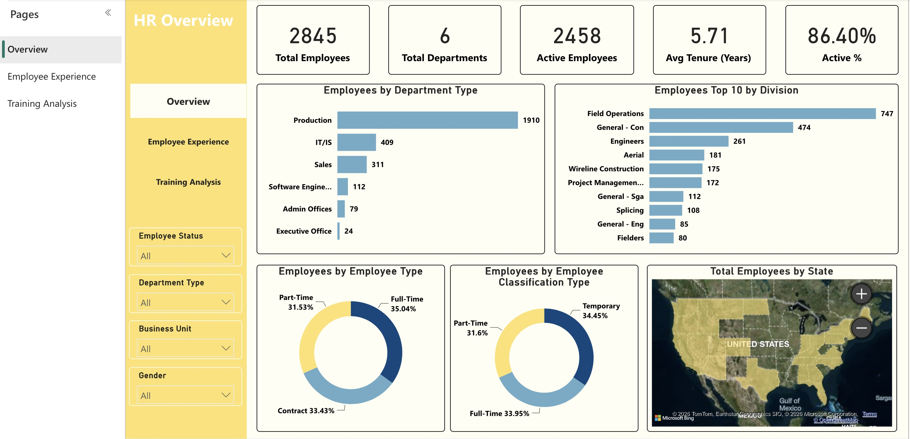
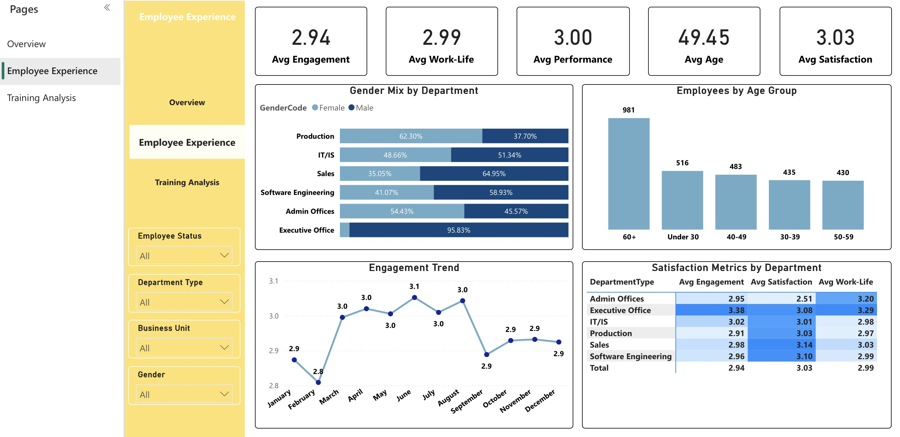
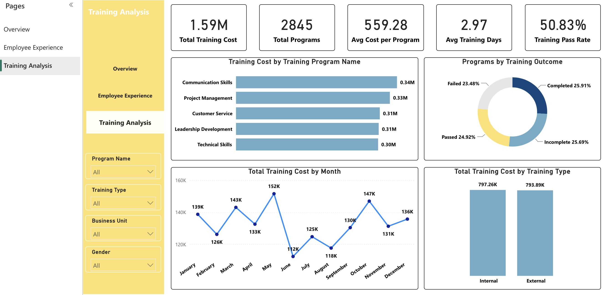

# HR Analytics Dashboard | Power BI

An interactive 3-page Power BI dashboard analyzing workforce structure, employee experience, and training performance for a company of 2,845 employees.

## Dashboard Pages

### 1. Overview

### 2. Employee Experience

### 3. Training Analysis

## Key Insights

**Workforce**
- 2,845 employees across 6 departments, with 86.4% active and an average tenure of 5.7 years.
- Production is the largest department (1,910 employees, about 67% of the workforce).
- Employee types are evenly balanced between full-time, part-time, and contract (31–35% each).
  
**Employee Experience**
- Average engagement, satisfaction, performance, and work-life scores all sit around 3.0, showing a neutral overall experience with room to improve.
- Admin Offices has the lowest satisfaction score (2.51), while Executive Office has the highest engagement (3.38).
- Employees aged 60+ form the largest age group (981), suggesting a need for succession planning.

**Training**
- Total training cost reached 1.59M across 2,845 programs, averaging 559 per program and about 3 training days.
- The training pass rate is only 50.8%, and outcomes are split almost equally between completed, incomplete, passed, and failed.
- Internal and external training costs are nearly equal (797K vs 794K).
- Communication Skills is the most expensive program (0.34M).
  
## Features
- 3 report pages with page navigation buttons
- Synced slicers: Employee Status, Department Type, Business Unit, Gender
- Separate measure tables organized by topic
- KPI cards, bar charts, donut charts, trend lines, a map, and a matrix with conditional formatting

## Tools
- Power BI Desktop
- Power Query
- DAX

## Dataset
Source: Kaggle

## Files
- [CleanedHR.pbix](CleanedHR.pbix): Power BI report file
- [images](images): dashboard screenshots
